# Cloudflare Security Rules

Cloudflare's Web Application Firewall (WAF) helps protect your website from malicious traffic, brute-force attacks, bots, and other security threats. This guide explains how to create common security rules for WordPress websites.

## Prerequisites

Before creating any rules:

1. Log in to your [Cloudflare](https://www.cloudflare.com/) dashboard.
2. Select your website.
3. Navigate to **Security > Security rules**.
4. Click **Create rule**.

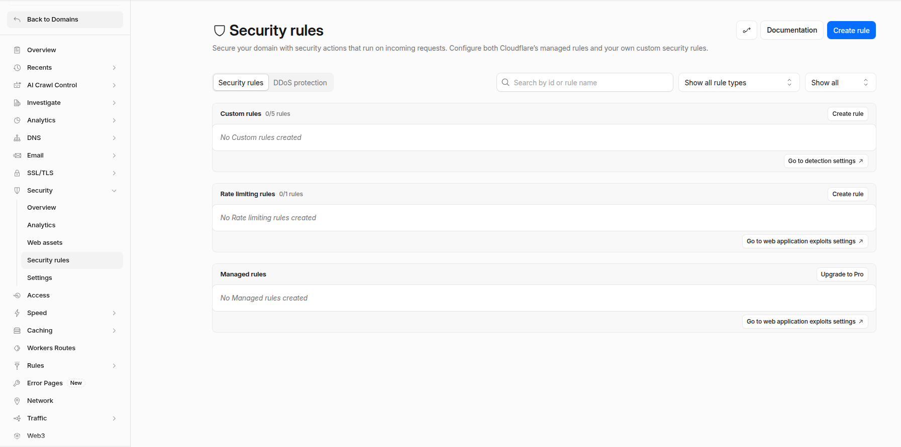

---

## Configure a Rate Limiting Rule (Free Plan)

Rate limiting helps protect your website from brute-force attacks and excessive requests.

**Step 1.** Navigate to Rate Limiting Rules

1. Open your Cloudflare dashboard.
2. Select your domain.
3. Go to **Security > Security rules**.
4. Click **Create rule**.
5. Click **Rate limiting rules**.

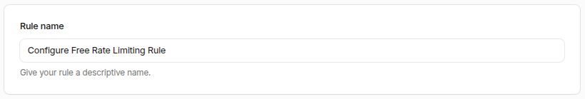

**Step 2.** Configure Rate Limit Settings

Set the rule name and the matching expression (for example, **URI Path** equals `/wp-login.php`), then configure the following settings:

| Setting  | Value                  |
| -------- | ---------------------- |
| Requests | 5                      |
| Period   | 10 seconds (free plan) |
| Action   | Block (free plan)      |
| Duration | 10 seconds (free plan) |
| Status   | Active                 |

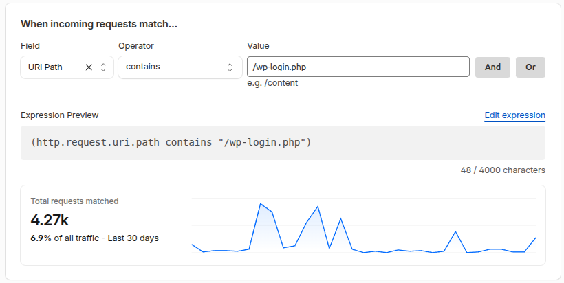

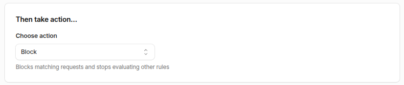

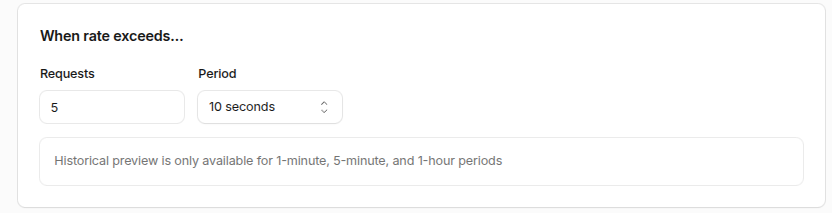

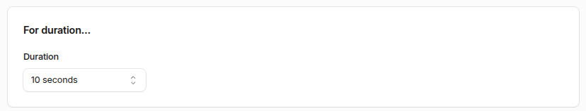

**Step 3.** Deploy the Rule

1. Review the configuration.
2. Click **Deploy**.
3. Verify that the rule appears in the rate limiting rules list.

---

## Combine Core WordPress Path Protections

Challenge access to `/xmlrpc.php`, `/wp-login.php`, and `/wp-comments-post.php` to reduce brute-force attacks, DDoS abuse, and automated comment spam. Make sure your website does not require these endpoints for automated clients (for example, Jetpack or the WordPress mobile app use `/xmlrpc.php`) before enabling the rule.

**Step 1.** Create a Custom Rule

1. Open **Security > Security rules**.
2. Click **Create rule**.
3. Click **Custom rules**.

**Step 2.** Configure the Rule

| Field     | Operator | Value                                                        |
| --------- | -------- | ------------------------------------------------------------ |
| Rule name |          | Protect WP Endpoints                                         |
| URI Path  | contains | `/xmlrpc.php` **or** `/wp-login.php` **or** `/wp-comments-post.php` |
| Action    |          | Managed Challenge                                            |
| Status    |          | Active                                                       |

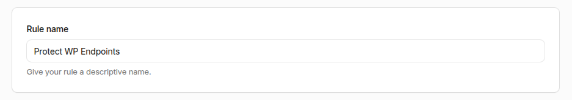
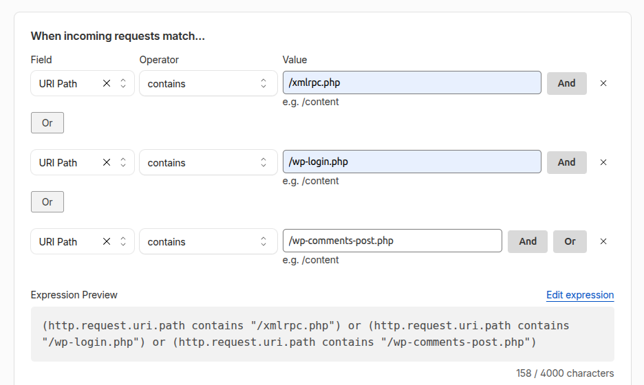
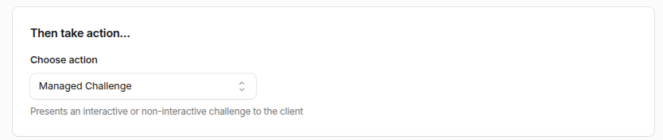

**Step 3.** Deploy the Rule

1. Click **Deploy**.
2. Test access to the following URLs:

    ```text
    https://yourdomain.com/xmlrpc.php
    https://yourdomain.com/wp-login.php
    https://yourdomain.com/wp-comments-post.php
    ```

    Cloudflare should present a challenge for each request.

---

## Block Generic Script User-Agents

This rule blocks incoming HTTP requests when the User-Agent header contains `python`, `curl`, `wget`, or `go-http-client` (in any letter case), or when the User-Agent header is empty. This rule does not identify all bots or automated traffic, and clients can bypass User-Agent matching by changing or spoofing their header.

> **Note:** Some legitimate services (such as uptime monitors, payment webhooks, and API integrations) may use these User-Agents. Review your integrations before enabling this rule.

**Step 1.** Create a Custom Rule

1. Navigate to **Security > Security rules**.
2. Click **Create rule**.
3. Click **Custom rules**.

**Step 2.** Configure the Rule

| Field      | Operator | Value                                                        |
| ---------- | -------- | ------------------------------------------------------------ |
| Rule name  |          | Block Automated HTTP Clients                                 |
| User Agent | contains | `python` **or** `curl` **or** `wget` **or** `go-http-client` |
| User Agent | equals   | *(empty)* **or** use the condition below                     |
| Action     |          | Block                                                        |
| Status     |          | Active                                                       |

The `contains` operator is case-sensitive. To match regardless of letter case, use **Edit expression** and enter:

```text
(http.user_agent contains "python") or
(http.user_agent contains "curl") or
(http.user_agent contains "wget") or
(http.user_agent contains "go-http-client") or
(http.user_agent eq "")
```

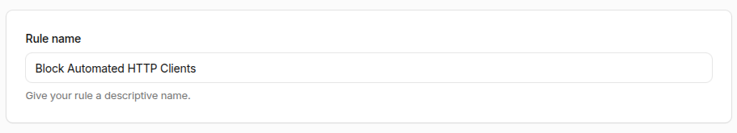
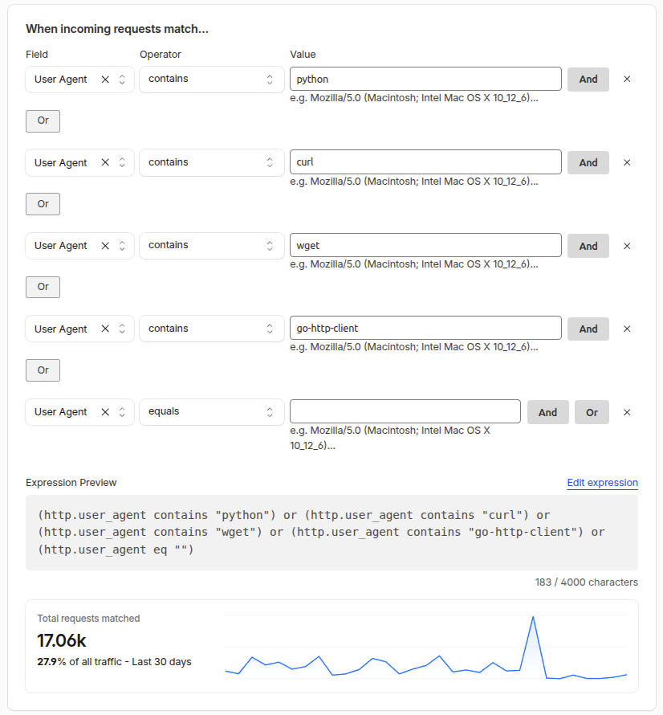
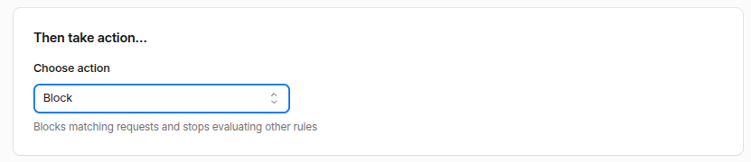

**Step 3.** Deploy the Rule

1. Review the rule expression and action.
2. Click **Deploy** to activate the rule.
3. Monitor the Security Events dashboard to verify that requests are being blocked as expected.

---

## Challenge Non-Target Country Traffic

This rule challenges requests from countries outside your target markets using Cloudflare Managed Challenge. It reduces unwanted traffic while allowing legitimate visitors to access your website. Make sure required users and business regions are not challenged by mistake.

**Step 1.** Create a Custom Rule

1. Navigate to **Security > Security rules**.
2. Click **Create rule**.
3. Click **Custom rules**.

**Step 2.** Configure the Rule

| Field     | Operator   | Value                                        |
| --------- | ---------- | -------------------------------------------- |
| Rule name |            | Geo-Challenge Unintended Traffic             |
| Country   | is not in  | Your target countries (for example, `India`, `US`) |
| Action    |            | Managed Challenge                            |
| Status    |            | Active                                       |

Use **does not equal** if you have a single target country, or **is not in** if you have several.

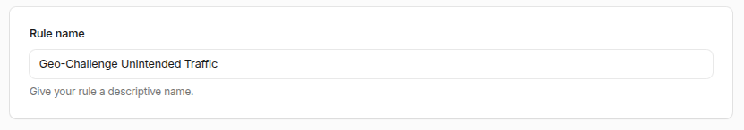
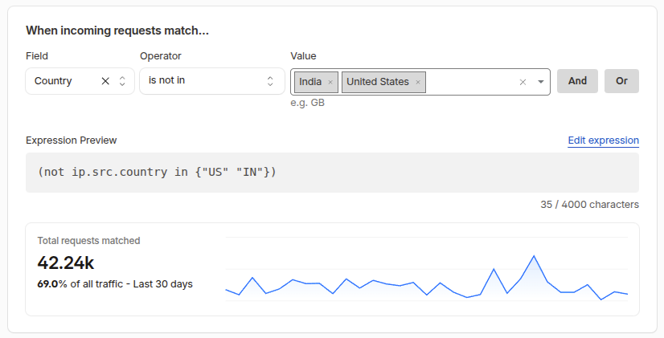


**Step 3.** Deploy the Rule

1. Review the rule expression and action.
2. Click **Deploy** to activate the rule.

---

## Enable Bot Fight Mode

Bot Fight Mode helps detect and mitigate automated bot traffic, reducing unwanted requests and protecting your website from malicious bots.

**Step 1.** Navigate to **Security > Settings**.

**Step 2.** Scroll to **Bot traffic**.

    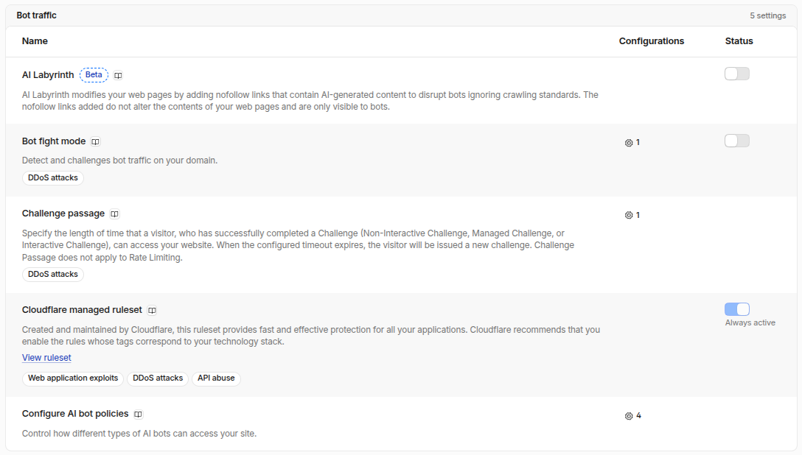

**Step 3.** Enable **Bot fight mode**.

    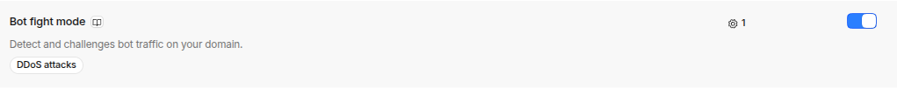

---

## Enable Browser Integrity Check

Bot Fight Mode helps detect and mitigate automated bot traffic, reducing unwanted requests and protecting your website from malicious bots.

**Step 1.** Navigate to **Security > Settings**.

**Step 2.** Scroll to **DDoS Attacks**.

    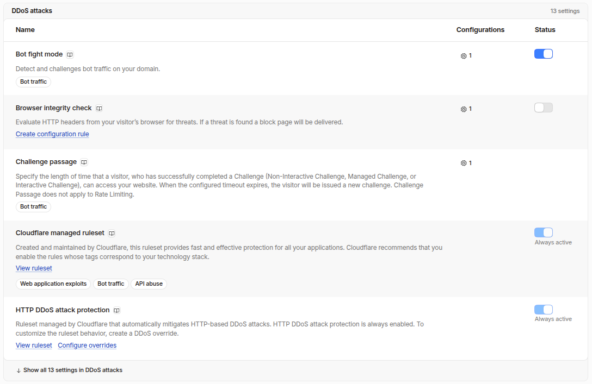

**Step 3.** Enable **Browser Integrity Check**.

    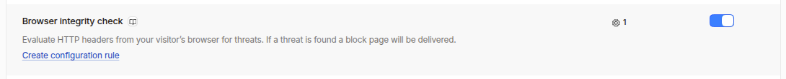

---

## Best Practices

* Use **Managed Challenge** instead of **Block** whenever possible.
* Monitor Cloudflare Security Events after deploying new rules.
* Test each rule before applying it to a production environment.
* Review security logs regularly for false positives.
* Combine security rules with rate limiting for stronger protection.

## Troubleshooting

### Legitimate Users Are Being Blocked

1. Open **Security > Events**.
2. Locate the blocked requests.
3. Review the triggering rule.
4. Modify the rule or add an exception if necessary.

### Login Page Is Inaccessible

1. Verify the rule expression.
2. Check the rule action.
3. Temporarily disable the rule for testing.
4. Confirm there are no conflicting Cloudflare rules.