# Cloudflare Zero Trust: Enable Email OTP Authentication for WordPress

Cloudflare Zero Trust Access adds an extra layer of security to your applications and WordPress login pages by requiring users to verify their identity before they can access them.

With Email One-Time Password (OTP) authentication, users receive a unique, single-use code directly in their email. They can use this code to securely sign in without installing an authenticator app or using a security key.

Cloudflare Access sits in front of the application and evaluates incoming requests against the configured Access policies before forwarding authorized requests to the origin.

---

## Why We Need Email OTP Based Authentication

* **No Authenticator App Required**: Users do not need to download, scan QR codes, or manage TOTP applications.
* **Edge-Level Protection**: Cloudflare Access evaluates authentication and access policies before forwarding authorized requests to your origin, helping reduce unauthorized traffic reaching your WordPress installation.
* **Seamless Onboarding**: Easily grant or revoke access for contractors, clients, or team members by simply adding their email address to an access policy.
* **Zero Infrastructure Overhead**: Cloudflare handles login sessions, token generation, and email dispatch out of the box.

---

## Prerequisites

Before setting up Email OTP-based Authentication:

1. A domain using Cloudflare DNS/proxy.
2. Access to the [Cloudflare Dashboard](https://dash.cloudflare.com/).
3. A Cloudflare Zero Trust organization (the Free plan is sufficient).
4. Access to the email inboxes of authorized users.

---

## Step 1: Access Cloudflare Zero Trust & Verify Identity Provider

Cloudflare Access supports One-Time PIN (OTP) as a built-in email-based authentication method. For newly created Zero Trust organizations, OTP may not be enabled by default, so you may need to add it under Zero Trust → Integrations → Identity providers.

1. Log in to the [Cloudflare Dashboard](https://dash.cloudflare.com/).
2. Select **Zero Trust** from the left navigation sidebar.
3. Navigate to **Integrations > Identity Providers**.

    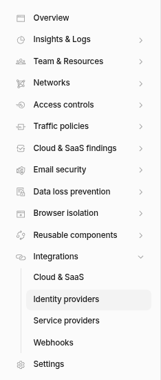

4. Click **Add an Identity Provider**.

    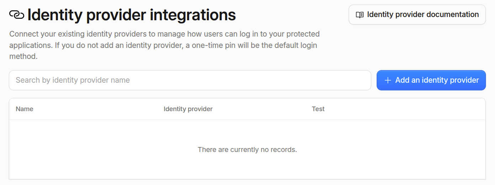

5. Select **One-Time PIN** from the list of identity providers.

    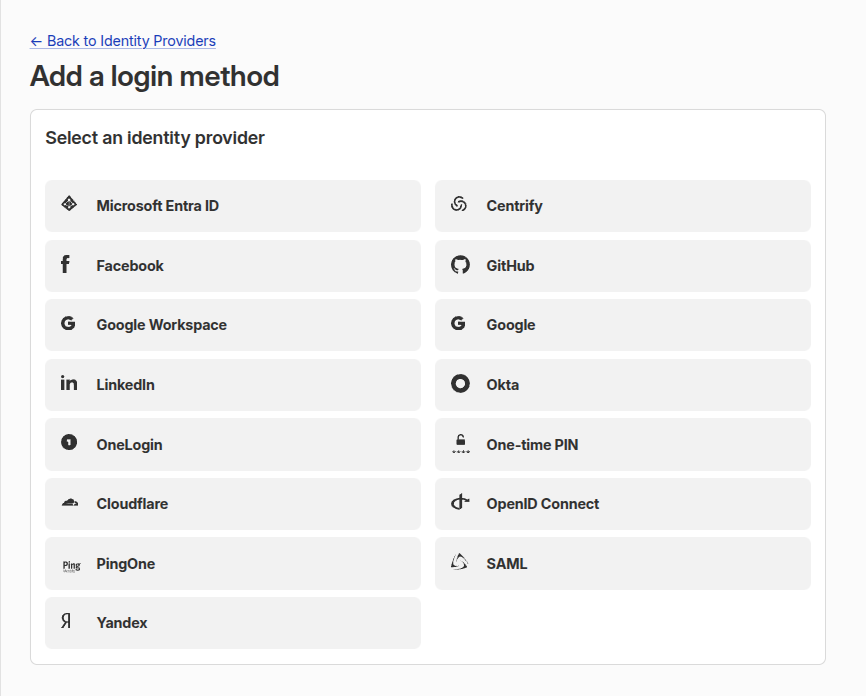

6. After adding it, **One-Time PIN** will appear as an enabled identity provider.
7. Return to the Identity Providers page.

    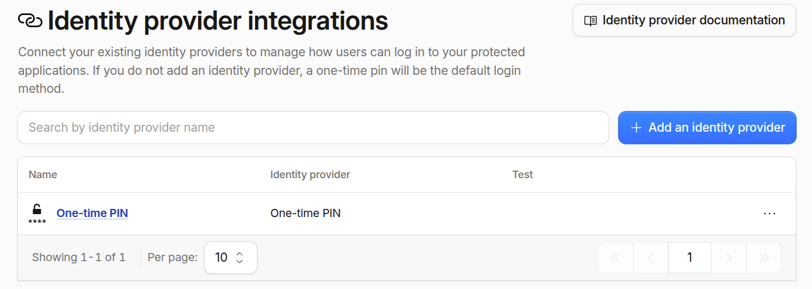

---

## Step 2: Configure Access Policies

1. In the Zero Trust Dashboard, go to **Access controls > Policies**.

    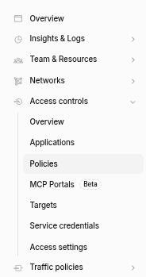

2. Click on **Add a Policy**.

    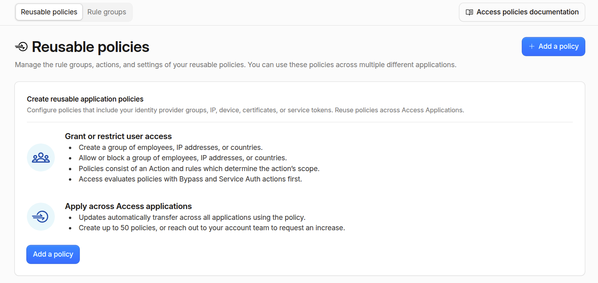

3. Fill **Policy** details.
    | Field | Description | Value |
    | :--- | :--- | :--- |
    | **Include** | Who is allowed to access the application | Email → [`[EMAIL_ADDRESS]` or `example.com`] |
    | **Name** | Name of the policy | example: `Email OTP Policy` |
    | **Action** | Action to take | `Allow` |
    | **Session Duration** | Session duration | example: `24 hours` |

    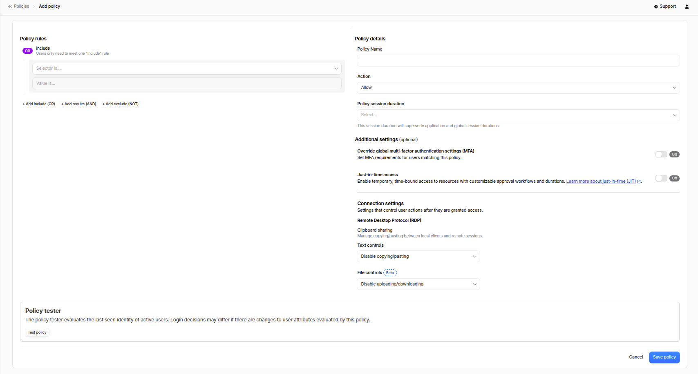
    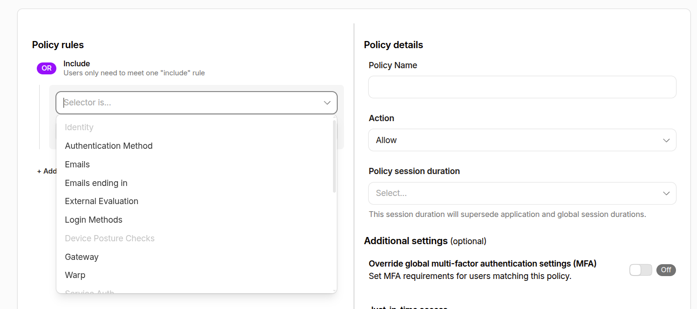

4. Click on **Save policy**.


:::important
Always combine the One-Time PIN login method with an appropriate Include rule, such as a specific email address or email domain. Do not configure One-Time PIN as the only access condition, as this could allow unintended users to authenticate with their own email address.
:::

---

## Step 3: Create a Cloudflare Access Application

Next, create an Access Application to define which URLs or endpoints require Email OTP authentication.

1. In the Zero Trust Dashboard, go to **Access controls > Applications**.

    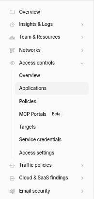

2. Click **Add an Application**.

    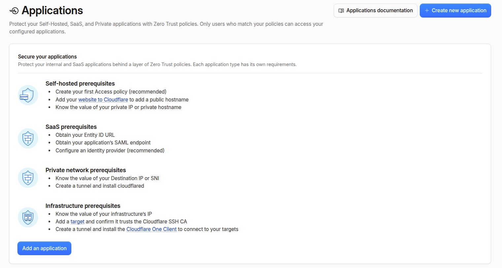

3. Select **Self-hosted and private** as the application type.

    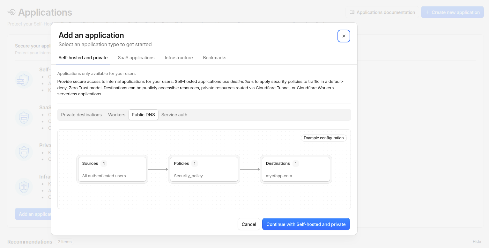

4. Select **Public DNS** and click on **continue with Self-hosted and private**.
5. Configure the **Application Configuration** details:

    | Setting | Description | Example Value |
    | :--- | :--- | :--- |
    | **Subdomain** | (Optional) Subdomain of your site | `www` or leave blank for root |
    | **Domain** | Select your proxied domain name | example: `example.com` |
    | **Path** | Specific path to protect | example: `wp-login.php` |
    | **Application Name** | A descriptive label | example: `Protect WP Admin` |
    | **Session Duration** | How long a user remains logged in | example: `24 hours` or `7 days` or `other` |

    ```text
    Protected URL Example:
    https://example.com/wp-login.php
    ```

    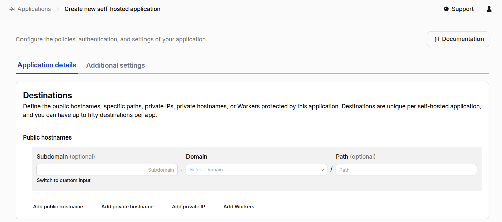

6. Select **Policy Name** from the dropdown (e.g., `Email OTP Policy`).

    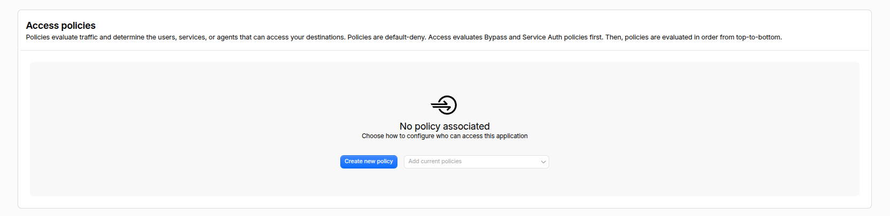

7. Verify that the selected Access policy requires **One-Time PIN** as the login method.

    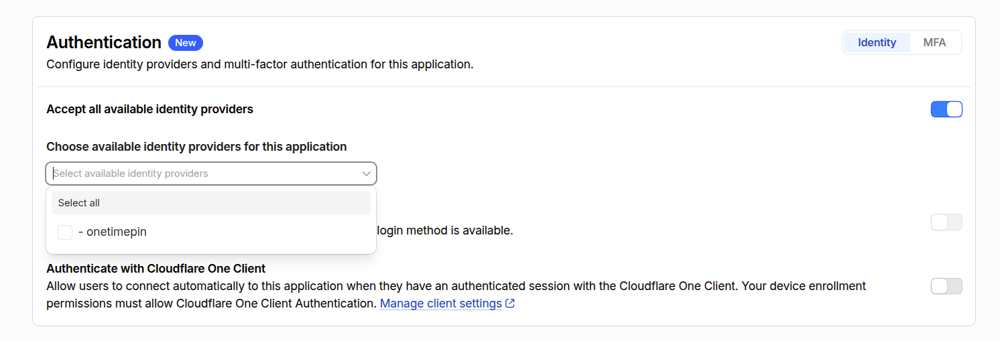

8. The Preview section displays the selected policy and its authentication requirements.

    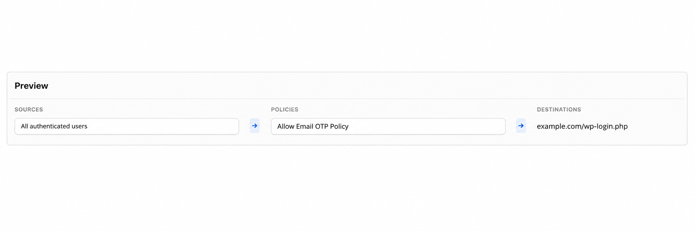

9. In the Details section, enter an application Name (for example, Email OTP Authentication) and configure the desired Session Duration, such as 24 hours.
    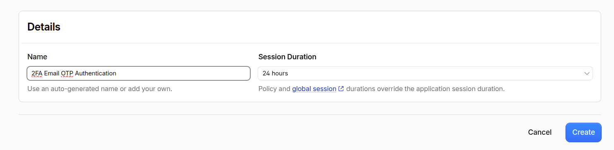

10. Click on **Create** button.

---

## Step 4: Test the Email OTP Authentication

1. Open your website in a new browser or incognito window.
2. Navigate to the protected URL (e.g., `https://example.com/wp-login.php`).
3. You should be redirected to the Cloudflare Access login page.

    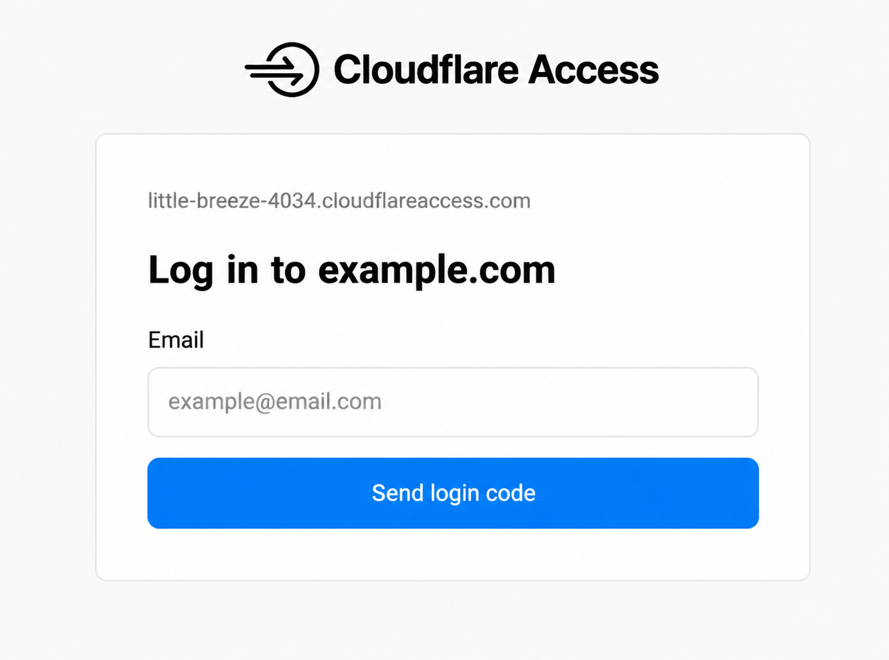

4. Enter your email address and click **Send Login code**.
5. Check your email inbox for the OTP code.
6. Enter the OTP code in the Cloudflare Access login page.
7. Click **Continue or Verify** to access the protected page.
8. The OTP is single-use and expires after 10 minutes. Requesting a new OTP invalidates the previous code.

---

## Best Practices

* **Enforce Reasonable Session Lengths**: For sensitive admin areas, set session durations to 12 or 24 hours to ensure inactive sessions expire cleanly.
* **Customize Access Branding**: Personalize the authentication portal under **Zero Trust > Settings > Customization** with your logo and organization name.
* **Monitor Access Logs**: Check login activity, authentication successes, and denied attempts under **Zero Trust > Logs > Access**.
* **Use Bypass Rules for Automated Services**: If external APIs, webhooks, or cron services need access to protected paths, create specific **Service Token** or **IP Bypass** rules.

---

## Troubleshooting

### OTP Email Not Arriving
1. Check spam, junk, or promotional email folders.
2. Verify that the email address matches the Access policy.
3. Check your organization's email gateway or security filter.
4. Allowlist notify.cloudflare.com or noreply@notify.cloudflare.com if your mail security system blocks Cloudflare OTP emails.

---

## Summary

Implementing Email OTP authentication with Cloudflare Zero Trust adds an additional layer of security to your websites and WordPress environments. Cloudflare Access authenticates users and evaluates access policies before forwarding authorized requests to your origin, helping reduce unauthorized access and brute-force attempts against protected WordPress endpoints. Only users who satisfy the configured access policy can reach the protected application.

Email OTP authentication protects the WordPress endpoint at the Cloudflare layer; it does not replace WordPress's own username and password authentication. Users may still need to sign in to WordPress after successfully completing the Cloudflare Access authentication.